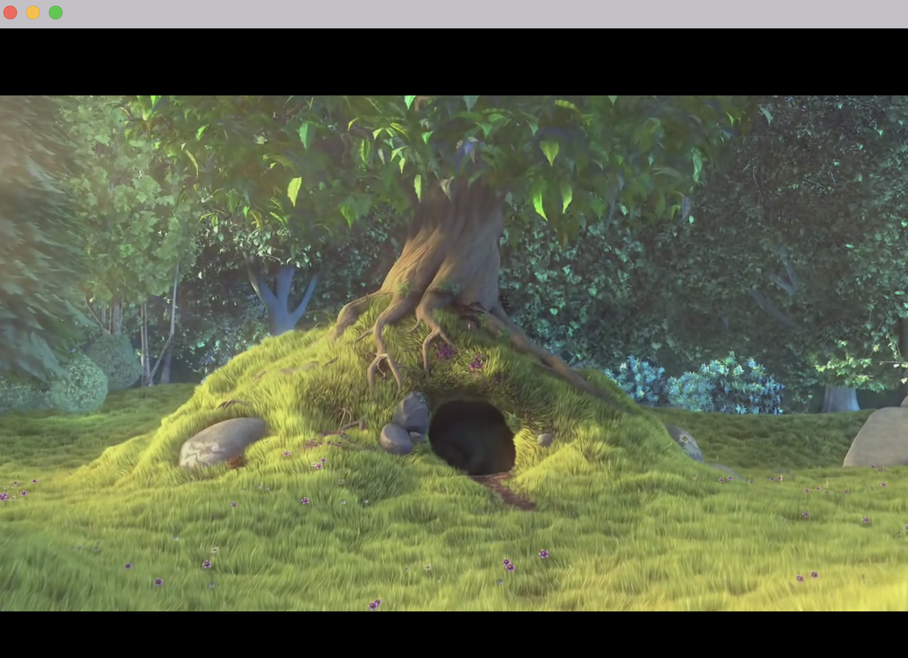

# `gpui-video-player`

A video player library for [gpui](https://github.com/zed-industries/zed/tree/main/crates/gpui) applications, built on top of GStreamer. This library provides efficient video playback with hardware-accelerated rendering on supported platforms.



## Installation

### GStreamer Dependencies

This library requires GStreamer and its plugins to be installed on your system. Please refer to the [GStreamer Rust bindings installation guide](https://github.com/sdroege/gstreamer-rs?tab=readme-ov-file#installation) for detailed instructions.

**Minimum Requirements:**
- GStreamer 1.14+
- gst-plugins-base 1.14+
- gst-plugins-good (recommended)
- gst-plugins-bad (recommended for additional codec support)

### Adding to Your Project

Add this to your `Cargo.toml`:

```toml
[dependencies]
gpui = "0.2"
gpui-video-player = "0.1.3"
```

The default `gpui` feature uses GPUI 0.2. To use `gpui-pre` instead:

```toml
[dependencies]
gpui = { package = "gpui-pre", version = "=0.3.9", default-features = false }
gpui_platform = { package = "gpui-pre-platform", version = "=0.3.9", features = ["font-kit"] }
gpui-video-player = { version = "0.1.3", default-features = false, features = ["gpui-pre"] }
```

If both features are enabled, `gpui-pre` takes precedence. Only the selected backend's
types are supported by `VideoElement`; use the same GPUI package in your application.
The selected backend is also re-exported as `gpui_video_player::gpui`.
Keep `gpui-pre` and `gpui-pre-platform` pinned to the same exact version (`=0.3.9`)
to avoid API/type mismatches during dependency updates. The platform dependency's
`font-kit` feature enables the macOS text backend; consumers must enable it too
(the library's dev-dependencies do not enable features in downstream applications).

## Usage

### Basic Video Playback

This example uses the `gpui-pre` dependencies above. With the default GPUI 0.2
backend, replace `gpui_platform::application()` with `gpui::Application::new()`.
Add `env_logger = "0.11"` and `url = "2"` to your application dependencies.

```rust
use gpui::{App, Context, Render, Window, WindowOptions, div, prelude::*};
use gpui_video_player::{Video, video};
use url::Url;

struct VideoPlayer {
    video: Video,
}

impl Render for VideoPlayer {
    fn render(&mut self, _window: &mut Window, _cx: &mut Context<Self>) -> impl IntoElement {
        div()
            .size_full()
            .flex()
            .items_center()
            .justify_center()
            .child(
                video(self.video.clone())
                    .id("main-video")
                    .buffer_capacity(30), // Buffer up to 30 frames
            )
    }
}

fn main() -> Result<(), Box<dyn std::error::Error>> {
    env_logger::init();
    let path = std::env::current_dir()?.join("path/to/your/video.mp4");
    let uri = Url::from_file_path(path).map_err(|_| {
        std::io::Error::new(std::io::ErrorKind::InvalidInput, "invalid video path")
    })?;
    let video = Video::new(&uri)?;
    let application = gpui_platform::application();
    application.run(move |cx: &mut App| {
        if let Err(error) = cx.open_window(
            WindowOptions {
                focus: true,
                ..Default::default()
            },
            |_, cx| cx.new(|_| VideoPlayer { video }),
        ) {
            eprintln!("failed to open window: {error}");
            cx.quit();
            return;
        }
        cx.activate(true);
    });
    Ok(())
}
```

### Video Controls

```rust
use gpui_video_player::Video;
use std::time::Duration;

// Playback control
video.set_paused(true);  // Pause
video.set_paused(false); // Resume

// Seeking
video.seek(Duration::from_secs(30), false)?; // Seek to 30 seconds

// Volume control
video.set_volume(0.5); // 50% volume
video.set_muted(true); // Mute

// Speed control
video.set_speed(2.0)?; // 2x speed

// Display size
video.set_display_width(Some(800)); // Override width
video.set_display_height(Some(600)); // Override height
```

### Advanced Configuration

```rust
use gpui_video_player::{Video, VideoOptions, video};

let options = VideoOptions {
    frame_buffer_capacity: Some(10), // Buffer 10 frames
    looping: Some(true),            // Enable looping
    speed: Some(1.5),               // 1.5x speed
};

let video = Video::new_with_options(&uri, options)?;
```

### Looping Playback Example

```rust
use gpui_video_player::{Video, VideoOptions};

let looped_video = Video::new_with_options(
    &uri,
    VideoOptions {
        looping: Some(true),
        ..VideoOptions::default()
    },
)?;

looped_video.set_looping(true);
```

Call `set_looping(true)` at runtime whenever you want to ensure the current stream loops.

### Custom Video Element

```rust
use gpui_video_player::{VideoElement, video};

let video_element = video(my_video)
    .id("custom-video")
    .size(px(640.0), px(480.0))  // Set display size
    .buffer_capacity(5);         // Buffer 5 frames
```

## API Reference

### Video

The main video player struct with methods for:

- **Playback Control**: `set_paused()`, `paused()`
- **Seeking**: `seek()`, `position()`, `duration()`
- **Audio**: `set_volume()`, `volume()`, `set_muted()`, `muted()`
- **Speed**: `set_speed()`, `speed()`
- **Display**: `display_size()`, `set_display_size()`
- **Frame Access**: `current_frame_data()`, `take_frame_ready()`

### VideoElement

GPUI element for rendering video with:

- **Sizing**: `size()`, `width()`, `height()`
- **Buffering**: `buffer_capacity()`
- **Identification**: `id()`

### Position

Time or frame-based positioning:

```rust
use gpui_video_player::Position;
use std::time::Duration;

let time_pos = Position::Time(Duration::from_secs(10));
let frame_pos = Position::Frame(300);
```

## Examples

Run the included examples to see the library in action:

```bash
# Basic video player
cargo run --example video_player

# Video player with controls
cargo run --example with_controls

# Looping playback
cargo run --example looping

# Any example with gpui-pre
cargo run --no-default-features --features gpui-pre --example video_player
```

The `with_controls` example uses GPUI `div` controls so it can compile against
both backends without introducing `gpui-component`'s separate GPUI types. Controls
support Tab/Shift-Tab navigation, Enter/Space activation, visible focus, and text
labels. They are demonstration controls, not full `Button` replacements: native
accessibility button roles and screen-reader actions are not implemented. For a
production UI, use accessible components compatible with your selected backend.

## Platform Notes

### macOS

For the gpui-pre backend, the Core Video bridge retains a separate reference for
GPUI's scene. The source wrapper and scene each release their own reference;
frame replacement and window teardown must release the scene's ownership.

Run the ownership regression and real-window stress checks on a macOS desktop:

```bash
cargo test --no-default-features --features gpui-pre --lib retained_pixel_buffer
RUST_LOG=gpui_video_player::element=trace,video_player=info cargo run --no-default-features --features gpui-pre --example video_player -- --stress
```

The stress mode plays the bundled clip in 20 successive windows, closing each
after one second. Check for native-surface trace messages and completion of all
20 cycles. Use Instruments Allocations/Leaks for longer memory investigations;
a passing smoke test alone does not prove absence of lifetime bugs or leaks.

- Uses `CVPixelBuffer` for hardware-accelerated rendering when possible
- Falls back to software rendering via GPUI sprite atlas

### Linux/Windows
- Uses optimized software rendering via GPUI sprite atlas
- Supports various GStreamer backends


## Contributing

Contributions are welcome! Please feel free to submit issues and pull requests.

## License

This project is licensed under the MIT License - see the [LICENSE](LICENSE) file for details.

## Credits

This project is inspired by and has referenced code from [iced_video_player](https://github.com/jazzfool/iced_video_player) by [@jazzfool](https://github.com/jazzfool).
